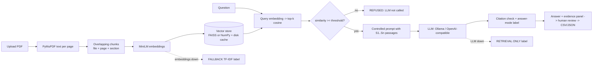

# Architecture and workflow (diagrams: `diagrams/architecture.png`, `diagrams/workflow.png`)

**Modules (Code/autodoc):** `ingest.py` (PDF), `retrieval.py` (chunking + TF-IDF fallback), `embeddings.py`, `vectorstore.py`, `llm.py`, `rag.py` (prompt, engine, citation check), `extract.py`, `compare.py`, `checks.py`, `exports.py`.
**Grounding controls:** context-only system prompt; untrusted-context rule; mandatory `[S#]` citations validated after generation; exact `INSUFFICIENT_EVIDENCE` reply; similarity gate that skips the LLM; temperature 0; evidence always displayed.
**Privacy boundary:** documents/embeddings local. LLM = Ollama on localhost (stays local) or a hosted endpoint (passages leave the machine).
**Deviations from the case-study reference stack:** no FastAPI, SQLite/PostgreSQL, graph store, RBAC, audit log; vector store is FAISS-or-NumPy rather than Chroma/Milvus.
